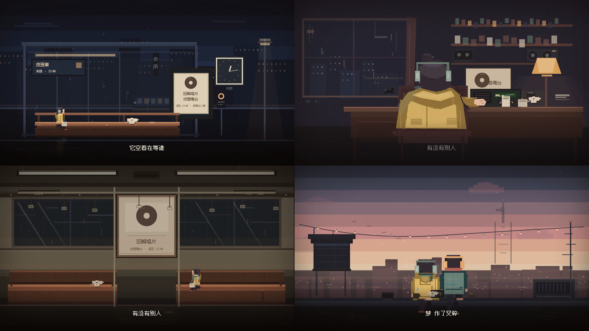
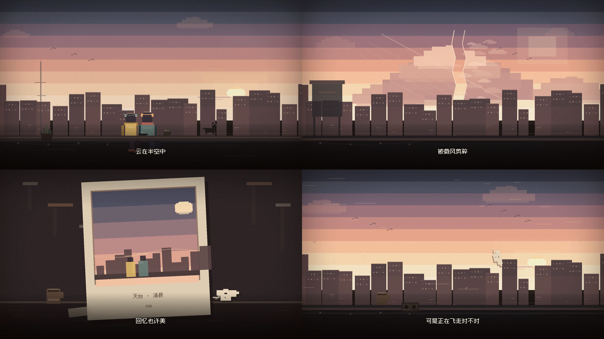
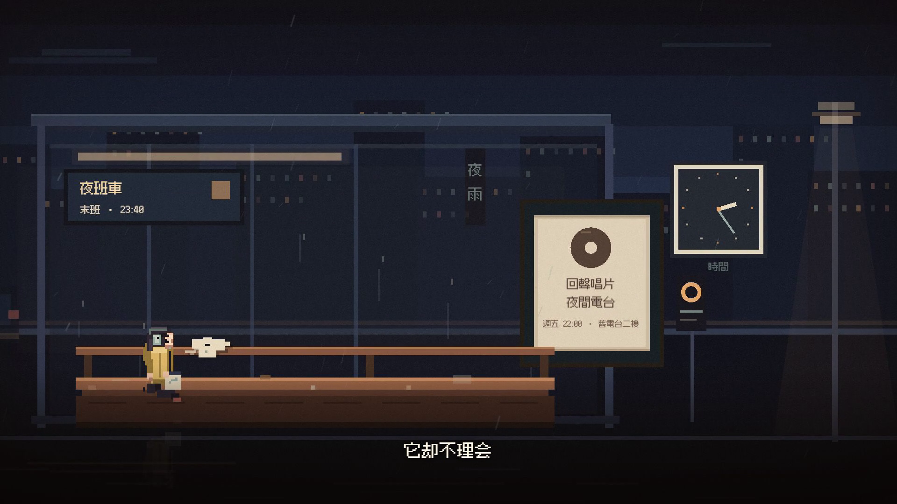

# 《同类》8-BIT PIXEL MV · 写实城市版

使用孙燕姿《同类》原曲与用户提供的歌词时间轴制作的 8-bit 像素风非官方 MV。画面、故事和像素动画为原创；音乐、歌词版权归原权利人所有。

## 观看

- **B 站：[《同类》8-bit 像素 MV](https://www.bilibili.com/video/BV1WaxF6rEHS/)**
- 仓库内只保留预览图、字幕和工程源码；完整视频与原始音轨不纳入 Git。





## 故事

雨后的城市里，一个女孩独自在末班公交站等车。空着的长椅上，有人留下一枚纸鹤。她把它带回家，放在旧收音机和磁带旁边。

末班地铁上，她看见一个安静的男孩，低头折着同样的纸鹤。车到站，他起身离开，座位上也留下一枚。她伸手把纸鹤收好。

她回到自己住的那栋楼，走上天台。男孩已经在那里，脚边放着一台旧磁带机。城市还在下雨，他们并肩坐在天台边，听着同一盘磁带，看灯一点点熄灭，直到天亮。

这是一个完全写实的城市日常故事：没有发光的鱼、没有天空中的鲸鱼、没有信号或魔法。只有雨、末班车、旧唱片店、纸鹤、磁带，和两个不太会说话的人。

## 完整分镜

> 时间按成片四舍五入到秒；相邻场景有约 0.2–0.5 秒的交叉淡化。全片共 13 个场景、约 26 个镜头。

| # | 时间 | 歌词 / 段落 | 画面 |
| --- | --- | --- | --- |
| 01 | 0:00–0:08 | 前奏 | 星空、月亮、城市剪影；窗台上的纸鹤、磁带和杯子；片名「同类 / KINDRED」与制作信息 |
| 02 | 0:08–0:13 | 雨后的城市 | 雨夜街道，女孩穿过「夜行、舊電台、唱片、雨具雜貨、夜宵」等招牌；出租车和湿路面反光 |
| 03 | 0:13–0:18 | 雨后的城市 | 公交站、路灯、屋檐下的猫；她沿着积水走向站台 |
| 04 | 0:18–0:23 | 寂寞又狼狈 | 十字路口伞群；影院「夜戲」招牌；她逆着人流停住 |
| 05 | 0:23–0:28 | 路边的座位 | 红灯倒计时，人流继续；她站在人群里不动，公交站「夜班車」亮着 |
| 06 | 0:28–0:35 | 它空着在等谁 | 公交站内：末班 23:40 路牌、回聲唱片传单、时钟、空长椅 |
| 07 | 0:35–0:42 | 我拉住时间 | 她坐下，发现长椅上的纸鹤，伸手拿起；雨和车灯从玻璃外掠过 |
| 08 | 0:42–0:53 | 它却不理会 / 有没有别人 | 公交站延续镜头，缓慢推近；她、纸鹤、时钟和雨，不再使用全屏侧脸大特写 |
| 09 | 0:53–1:04 | 跟我一样很想被安慰 | 房间：书桌、磁带架、旧收音机、桌上的纸鹤；猫趴在雨窗边 |
| 10 | 1:04–1:12 | 风停了又吹 | 夜巷：深夜食堂、舊電台、消防梯、汽水机、暖黄门洞 |
| 11 | 1:12–1:25 | 我忽然想起谁 / 天亮了又黑 | 巷子深处：蒸汽、猫、「回家」灯牌；她走过，白闪转场 |
| 12 | 1:25–1:35 | 我过了好几岁 / 心暖了又灰 | 末班地铁：老式座椅、回聲唱片海报、空座；男孩出现 |
| 13 | 1:35–1:45 | 世界有时孤单 | 两人对坐；她戴着耳机，他低头折纸鹤 |
| 14 | 1:45–1:53 | 需要另一个同类 | 车到站，男孩起身离开；黑场后，座位上留下一枚纸鹤 |
| 15 | 1:53–2:00 | 爱收了又给 / 我们都不太完美 | 空座与纸鹤特写；她伸手拿起；车窗外是唱片海报和站台灯 |
| 16 | 2:00–2:08 | 我拉住时间 | 天台到达：湿屋顶、水塔、串灯、城市；男孩站在边缘 |
| 17 | 2:08–2:18 | 它却不理会 | 她穿过屋顶走近；雨渐停；飞机、云和城市灯火 |
| 18 | 2:18–2:30 | 风停了又吹 | 两人并肩坐在天台边；旧磁带机和纸鹤放在旁边；城市夜景 |
| 19 | 2:30–2:48 | 我忽然想起谁 / 天亮了又黑 | 天色渐亮；云层、电视塔、鸟、串灯；城市从冷蓝变暖 |
| 20 | 2:48–2:57 | 不晓得为什么爱 / 又稀少又昂贵 | 天台静物：两只杯子、磁带机、纸鹤、车票；雨和城市虚焦 |
| 21 | 2:57–3:01 | 云在半空中 | 广角：两个人、日出、城市；云层缓慢移动 |
| 22 | 3:01–3:04 | 被微风剪碎 | 3.5 秒叠化进入云层；一朵云被风切开，亮边、云块和碎云向右飘散 |
| 23 | 3:04–3:07 | 被微风剪碎（后半） | 晾衣绳、碎云和风；云层继续散开 |
| 24 | 3:07–3:10 | 回忆也许美 | 宝丽来照片：天台清晨与两个人；旁边是杯子和纸鹤 |
| 25 | 3:10–3:18 | 可是正在飞走对不对 | 纸鹤被风卷起，越过城市；画面渐暗，进入片尾 |
| 26 | 3:18–3:32 | 尾奏 | 片尾字卡：同类 / KINDRED、音乐与影像 credits、非官方同人声明 |

### 2:57–3:18 结尾四镜头

| 歌词 | 画面 |
| --- | --- |
| 云在半空中 | 日出、天台上的两个人全景 |
| 被微风剪碎 | 2:59 起用 3.5 秒叠化进入云层；一朵云被风切开，云块和碎云飘散 |
| 回忆也许美 | 宝丽来照片：天台清晨与两个人 |
| 可是正在飞走对不对 | 纸鹤被风卷起，越过城市 |



## 技术信息

- 成片：1920×1080 / 24 fps / 3:32.71 / 5105 帧
- 编码：H.264 + AAC；母版约 -14 LUFS，true peak 约 -2.7 dBFS
- 歌词：按用户提供的 LRC 对齐，共 38 句，烧录字幕在 `out/tonglei-8bit-mv.srt`
- 画面：Remotion 4 + React + TypeScript + SVG，逐帧绘制
- 字体：Fusion Pixel 12px Proportional SC（OFL-1.1）、Press Start 2P（OFL-1.1）

## 工程

- 像素字体与所有场景代码都在 `src/`。
- 渲染脚本：`scripts/render-full.mjs`；关键帧预览：`scripts/stills.mjs`。
- 海报：`out/poster.png`。
- 仓库不包含音频文件；请自行放入 `public/audio/source.mp3`。

### 本地运行

```bash
npm install
# 将原曲放到 public/audio/source.mp3
npm run dev       # Remotion Studio 预览
npm run render    # 渲染到 out/tonglei-8bit-mv-final2.mp4
```

`public/audio/source.mp3` 需要自行放入，并确保拥有相应使用权限。

## 说明

- 这是非官方同人 MV，不代表孙燕姿、词曲作者或唱片公司。
- 原曲与歌词仅用于个人创作；公开发布、商业使用或再分发前请自行确认授权。
- 片中故事与像素画面为原创，没有使用原版 MV 画面。
- 仓库不包含完整视频和原曲音频；完整版请见上方 B 站链接。

---

FAN-MADE 8-BIT TRIBUTE · MADE WITH REMOTION
